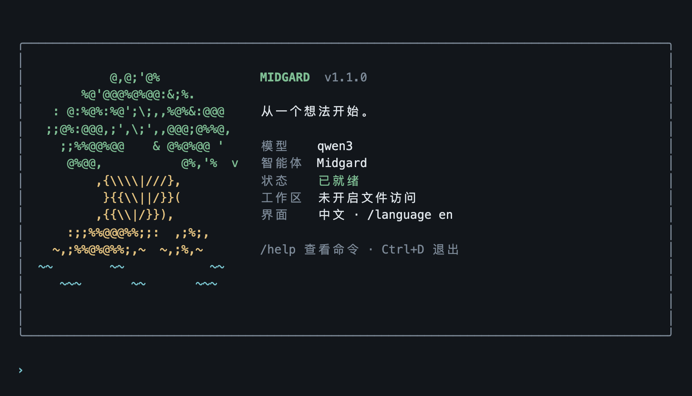

<div align="center">

# Midgard

**从一个想法，开始一段能继续推进的对话。**

在自己的电脑上连接喜欢的 AI 模型，整理资料、打磨内容、推进任务。<br>
打开就能聊，需要更多能力时，再一步步开启。

[开始使用](#开始使用) · [最新版本](https://github.com/injenium/Midgard-release/releases/latest) · [更新 Midgard](#更新-midgard) · [问题反馈](https://github.com/injenium/Midgard-release/issues)

</div>



<p align="center"><sub>终端界面示意。模型由你选择，也可以切换为英文界面。</sub></p>

## 用 Midgard 做什么

| 你想做的事 | 可以这样开始 |
| --- | --- |
| 把想法理清楚 | 拆解目标、列出下一步，或把零散笔记整理成计划。 |
| 和资料一起工作 | 添加文档作为对话材料，提炼重点、比较内容、继续追问。 |
| 把内容打磨好 | 起草邮件、修改表达、整理说明，在同一段对话里持续完善。 |

你可以直接在终端里对话，也可以运行 `midgard dashboard` 打开浏览器工作台。需要处理文件或使用外部工具时，再配置相应能力；不必在第一次打开时理解所有高级设置。

## 开始使用

### 1. 准备一个模型

Midgard 不附带模型或模型额度。你需要一个已运行的本地模型服务，或者模型服务商提供的兼容接口地址、模型名称和 API Key。向导会带你填写这些基本信息；密钥使用隐藏输入，不要把它粘贴进聊天内容。

### 2. 安装

在 **Apple 芯片 Mac** 或 **Linux** 的终端中执行以下命令，安装并使用中文界面：

```sh
curl -fsSL https://github.com/injenium/Midgard-release/releases/latest/download/install.sh | sh -s -- --version 1.1.3 --release-url https://github.com/injenium/Midgard-release/releases/download cn
```

想使用英文，把最后的 `cn` 换成 `en`。不加语言参数时，安装器默认英文；已有的界面偏好不会被无故重置。

Windows 用户需要在 WSL2 中安装。暂不提供原生 Windows 或 Intel Mac 安装包。

### 3. 开始对话

跟随安装后的向导连接模型。首次在本机使用时，选择首次设置；完成后按提示确认启动工作区即可。没有自动出现向导，或下次想继续使用时，运行：

```sh
midgard
```

不妨从一句话开始：

> “把我这个想法拆成三个可执行的步骤。”
>
> “帮我把这封邮件改得清楚、自然一些。”

## 少一点设置，多一点专注

直接输入文字就能聊天。以下几个命令按需使用即可：

| 想做什么 | 在聊天中输入 |
| --- | --- |
| 开始一段新对话 | `/new` |
| 添加一份资料 | `/attach "文件路径"` |
| 切换中英文 | `/language cn` 或 `/language en` |
| 查看更多操作 | `/help` |

输入 `/` 时会出现命令补全。按 `Ctrl+D` 可以退出当前聊天；后台工作区不会因此关闭。

高级配置保留在 `midgard onboard --mode custom`，平时不需要打开。界面语言只影响提示和菜单，不会改写你的资料或模型回复。

## 重要操作，由你决定

需要审批的操作会先显示工具及参数，明确输入 `yes` 才允许本次执行，直接回车会拒绝。没有配置文件访问范围时，Midgard 不会自行取得工作区文件权限。

对话与设置保存在本机。选择云端模型或外部工具时，相关内容仍会发送给你选择的服务，请按其隐私约定使用。

## 更新 Midgard

已经安装过，无需重新复制安装命令：

```sh
midgard update
```

普通更新会自动暂停已注册的后台服务、取消正在进行的任务，并生成本机加密恢复快照，无需反复确认或输入口令。更新完成后运行 `midgard service start` 重新启动服务。前台运行的服务需先自行退出；数据格式迁移仍会单独提示确认。

本机快照依赖原主密钥，不替代独立备份。旧版首次升级仍可能要求加上 `--stop-service`、确认和设置口令，后续升级才采用简化流程。

只想看看有没有新版本，可以运行 `midgard update --check`。每个版本的变化都在[更新记录](https://github.com/injenium/Midgard-release/releases)里。

## 遇到问题

<details>
<summary>安装后提示找不到 midgard</summary>

试试 `~/.local/bin/midgard`。如果能打开，将 `~/.local/bin` 加入你的 PATH 即可；安装器不会擅自修改 shell 配置。

</details>

<details>
<summary>暂时连不上模型，或没有收到回复</summary>

先确认本地模型服务已启动，或者服务商的接口地址、模型名称和密钥填写正确。跳过连接测试不代表连接已验证成功。

可以运行 `midgard doctor` 检查工作区状态。仍有问题时，请在[问题反馈](https://github.com/injenium/Midgard-release/issues)中附上系统、Midgard 版本、错误提示和复现步骤；不要提交密钥、配对码或私人对话。

</details>

<details>
<summary>安装位置、支持平台和其他说明</summary>

程序默认安装在 `~/.local/share/midgard`，个人数据默认保存在 `~/.midgard`。安装器会校验下载内容，不修改系统 Python。

提供 Apple 芯片 Mac、Linux x86_64 与 Linux ARM64 的安装包；Linux 需要 glibc 环境，不支持 Alpine 等 musl 环境。原生 Windows 与 Intel Mac 暂不提供安装包。

如果你通过 `midgard serve` 在前台运行服务，请先回到该窗口停止服务，再执行更新。停止工作区会影响正在执行的任务，操作前请确认。

本项目持续迭代中。模型服务商可能按使用量收费，重要结果请自行核对。

</details>

---

[下载最新版](https://github.com/injenium/Midgard-release/releases/latest) · [查看更新](https://github.com/injenium/Midgard-release/releases) · [Apache-2.0 许可](LICENSE)

这里是 Midgard 的官方安装与更新入口，不包含开发源码。
